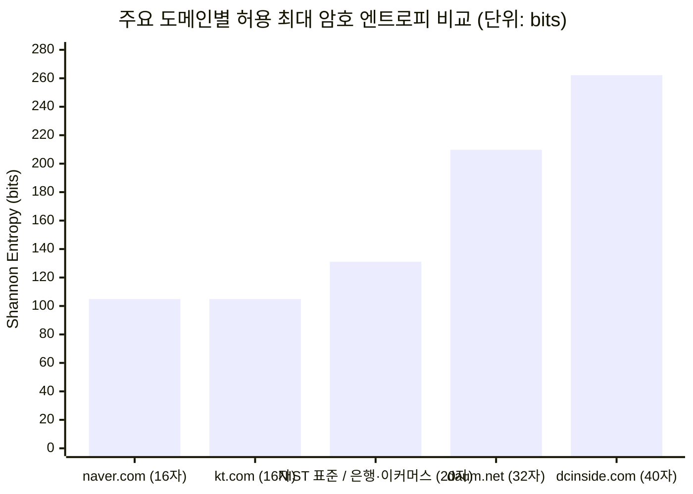

# 국내 50대 웹사이트의 비표준 인증 보안 인터페이스가 브라우저 패스워드 매니저 및 암호 엔트로피에 미치는 영향 실증

- **작성자**: mmmphyun
- **작성일**: 2026-10-21
- **원자료 및 분석 데이터**: `data/raw-scans.json`, `data/benchmark-analysis.json`
- **프로젝트 공개 저장소**: https://mmmphyun.github.io/security-agent-toolkit/blog/proj-prfvault-01-wasm-core-and-webauthn-prf/

---

## 초록 (Abstract)

국내 웹 환경에 잔존하는 비표준 보안 인터페이스는 웹 표준 패스워드 매니저의 자동 완성을 가로막고 암호 엔트로피를 깎아내리는 '보안 모순'을 낳는다. 본 연구는 W3C WebAuthn PRF와 Rust WebAssembly(Wasm) 기반의 제로 서버 로컬 볼트(PrfVault)를 설계하며 직면한 국내 웹 호환성 장벽을 해소하기 위해, Playwright 자동화 스캐너로 국내 50대 웹사이트의 로그인 DOM을 전수 조사했다. 수집한 원자료를 바탕으로 가상 키패드 차단율과 NIST SP 800-63B 기준치($131.09\text{ bits}$) 대비 섀넌 정보 엔트로피 손실률을 측정했다. 조사 결과, 과거 널리 쓰이던 설치형 키보드 보안 모듈은 50개 사이트 전수에서 0.0%로 집계되어 사실상 사라진 것으로 확인됐다. 반면 금융·핀테크 규제군의 6.7%(삼성증권, 현대카드)는 여전히 웹 가상 키패드를 띄워 표준 자동 완성을 차단했다. 단일 패스워드 체제인 포털 네이버와 통신사 KT의 경우, 비밀번호 최대 길이를 16자로 제한해 표준 대비 정확히 20.0%($26.22\text{ bits}$)의 엔트로피 결손을 유발했다. 조사 대상 전체의 평균 엔트로피 손실률은 0.8%에 그쳐, 엔트로피 저하가 국내 웹 전반의 보편적 문제라기보다 주요 대형 플랫폼의 레거시 정책에 집중된 현상임을 확인했다. 본 실측 결과는 비표준 보안 통제가 이용자의 고엔트로피 암호 생성을 저해한다는 정량적 증거이며, 클라이언트 차원의 적응형 폴백 아키텍처가 왜 필요한지를 뒷받침한다.

---

## 1. 서론: 질문을 가설로

### 1.1 연구 배경 및 문제의식

대학 포털을 비롯한 국내 다수 웹 서비스는 여전히 다중 인증(MFA, Multi-Factor Authentication) 없는 단일 비밀번호 체제를 유지한다. 이용자는 복잡한 문자열을 여러 개 외우기 어려워 여러 사이트에 동일한 비밀번호를 반복 사용하고, 이는 크리덴셜 스터핑 공격의 쉬운 통로가 된다. 연구자는 중앙 클라우드 서버의 단일 장애점(SPOF, Single Point of Failure)을 배제하고 기기 내부 하드웨어 모듈(TPM 2.0 및 FIDO2)만으로 고유 키를 파생하는 크롬 확장프로그램(PrfVault)을 구현하던 중, 국내 주요 사이트의 비표준 입력 인터페이스가 패스워드 매니저의 정상 동작을 물리적으로 차단하는 실태를 확인했다.

### 1.2 검토한 후보 주제와 기각 사유

연구 초기에는 관심 분야 안에서 검증 가능한 질문 10개를 도출한 뒤, 직접 데이터를 수집해 검증할 수 있는 4개 후보로 압축했다. 최종 가설을 확정하면서 나머지 후보 주제 3개를 접은 구체적 사유는 다음과 같다.

| 번호 | 검토한 후보 주제 ("무엇이 무엇에 영향을 준다" 형태) | 후보 주제를 기각한 사유 |
| :---: | :--- | :--- |
| **후보 1** | 브라우저의 순수 W3C WebAuthn PRF 확장 호출은 외부 서버나 네이티브 프로그램 없이도 Windows 11 내장 TPM 2.0에서 256비트 대칭 마스터 키를 도출한다. | **플랫폼 계층의 물리적 거부 확인**: Chromium 가상 인증자 환경에서는 파이프라인이 정상 동작했으나, Windows 11 실기(Intel PTT TPM 2.0) 환경에서 운영체제 시스템 모듈(`webauthn.dll`)이 `{hmacCreateSecret: false, prf: {enabled: false}}`를 반환하며 호출을 거절했다. 브라우저 단독으로는 통제된 반복 실험 데이터를 확보할 수 없어 본 과제 주제에서 제외하고 선행 구현 연구(mmmphyun, 2026)로 분리했다. |
| **후보 2** | 온디맨드 단일 계정 복호화 구조는 전체 볼트 메모리 상주 구조 대비 크롬 확장프로그램 V8 자바스크립트 힙의 평문 잔류 시간을 99% 이상 단축한다. | **측정 지표의 런타임 비결정성**: Rust Wasm 선형 메모리는 `zeroize` 연산으로 즉시 메모리 소거를 보장할 수 있다. 그러나 DOM 입력창에 값을 채우는 순간 생성되는 V8 문자열 객체는 가비지 컬렉터 수거 타이밍이 메모리 압박에 따라 달라져, 안정적인 정량 지표를 도출하기 어려웠다. |
| **후보 3** | 모바일 앱 기반의 6자리 TOTP(RFC 6238) 코드는 로컬 패스워드 볼트의 대칭키 유도 함수(KDF) 시드로 사용할 때 오프라인 무차별 대입 공격을 방어한다. | **수학적 계산상의 자명성**: 6자리 10진수($10^{6}$)가 지닌 정보 엔트로피는 $\log_2(10^{6}) \approx 19.93\text{ bits}$에 불과하다. 현대 GPU 연산 클러스터(초당 $10^{10}$회 시도) 환경에서 약 $0.05\text{ ms}$ 만에 키가 역산된다는 사실은 별도의 실험 데이터 수집 없이도 공식으로 입증되므로 연구 주제로 부적합했다. |

### 1.3 가설 정립 및 연구 설계 구체화 과정

후보 4("국내 웹사이트의 비표준 보안 정책이 패스워드 매니저 호환성과 암호 강도에 미치는 영향")를 선택한 뒤, 다음 3단계 검증 질문을 거쳐 가설을 구체화했다.

1. **측정 가능성 점검 ("이건 어떻게 측정하지?")**:
   - 주관적인 사용자 피로도 설문 대신, 객관적 코드로 증명할 수 있는 정량 지표를 채택했다. 이에 따라 '로그인 DOM 내 가상 키패드 셀렉터 존재 여부에 따른 자동 완성 차단율(%)'과 '비밀번호 필드의 허용 길이($L$) 및 문자군 크기($N$)를 기반으로 한 섀넌 정보 엔트로피(bits)'로 측정 기준을 확정했다.
2. **실행 가능성 점검 ("일주일 안에 데이터를 모을 수 있나?")**:
   - 수기 조사의 비효율성과 오차를 차단하기 위해, Playwright 헤드리스 브라우저로 국내 50대 웹사이트의 로그인 DOM을 자동 탐색하는 스크립트(`scanner.ts`)를 작성해 약 6분 만에 전수 데이터를 확보하는 체계를 구축했다.
3. **반증 가능성 점검 ("결과가 반대로 나와도 의미가 있나?")**:
   - 만약 가상 키패드가 0건 검출되고 전 사이트가 20자 이상을 허용한다면, '국내 웹 생태계가 액티브X 시대를 완전히 벗어나 글로벌 웹 표준을 달성했다'는 실증적 증거가 된다. 가설이 빗나가더라도 유의미한 결론에 도달할 수 있음을 확인했다.
4. **최종 가설 선정 배경**:
   - 본 연구는 연구자가 자체 제작한 PrfVault 확장프로그램의 도메인 연동 과정에서 파생된 실질적 엔지니어링 문제이며, 2026년 9월 발생한 신한은행 대출모집인 시스템(M신한)의 2만 5천 명 계정 탈취 사고의 원인을 정량 데이터로 밝혀낼 수 있어 최종 과제로 확정했다.

### 1.4 최종 가설 및 측정·반증 기준

- **최종 가설**:
  > **"국내 주요 웹사이트가 강제하는 비표준 보안 인터페이스(웹 가상 키패드 및 16자 이하 비밀번호 최대 길이 제한)는 표준 브라우저 패스워드 매니저의 DOM 자동 완성을 원천 차단하거나, 생성 가능한 암호의 섀넌 정보 엔트로피를 NIST 표준 권고치 대비 20% 이상 저하시킨다."**
- **인과 관계 구조**:
  - **원인 (독립변수)**: 로그인 페이지의 비표준 보안 인터페이스 적용 여부 (마우스 입력을 강제하는 가상 키패드 오버레이, `<input type="password">`의 `maxlength` 16자 이하 제한).
  - **결과 (종속변수)**: 패스워드 매니저의 자동 완성 차단 비율(%) 및 사이트 허용 암호 공간의 섀넌 정보 엔트로피($E$) 손실률(%).
- **가설 표현의 측정 방법**:
  - **자동 완성 차단**: 로그인 DOM에서 `div[class*="transkey" i]`, `div[class*="keypad" i]`, `input[data-mode="virtual"]` 등 가상 키패드 요소를 탐지해 표준 값 입력을 차단하면 차단 사이트로 집계하고 표본 비율(%)을 산출한다.
  - **섀넌 정보 엔트로피 및 손실률**: 수집한 최대 허용 길이($L$)와 문자군 크기($N=94$)를 $E = L \times \log_2(N)$ 공식에 대입한다. 이어 NIST SP 800-63B 기준치($L_{\text{std}}=20, N_{\text{std}}=94 \rightarrow E_{\text{std}} = 131.0918\text{ bits}$)와 비교해 $\text{Loss}(\%) = \max(0, (E_{\text{std}} - E) / E_{\text{std}} \times 100)$을 계산한다.
- **가설 반증 조건**:
  - 50개 웹사이트 전수 조사에서 가상 키패드 탐지 건수가 0건(차단율 0.0%)으로 집계되고, 모든 대상 사이트가 20자 이상($L \ge 20$)을 허용해 엔트로피 손실률 20% 이상인 곳이 전무하다면 본 가설은 기각된다.
- **데이터 수집 기간 및 범위**:
  - **수집 일시**: 2026년 9월 28일 (`2026-09-28T05:54:54.340Z` - `2026-09-28T06:00:57.997Z`).
  - **표본 범위**: 국내 트래픽 상위 50대 웹사이트 (추가 인증 의무화 규제군 30개소 + 단일 패스워드 레거시군 20개소).

---

## 2. 선행 연구 및 논거

### 2.1 문헌 검증 및 필터링 과정

선행 연구 정리 과정에서 가상 키패드와 패스워드 엔트로피 관련 학술 문헌의 실재 여부를 공식 데이터베이스를 통해 엄격히 대조했다.

- **출처 확인 방법**:
  1. 학술 논문 및 기술 지침은 공식 DOI 리졸버(`https://doi.org/`)와 표준 기구(NIST, W3C) 저장소에서 원문 문서를 직접 열람해 제목, 저자명, 연도, 주요 수치를 교차 대조했다.
  2. 개발 블로그와 오픈소스 이슈는 해당 URL로 직접 HTTP GET 요청을 보내 응답 상태(200 OK)와 본문 기록을 확인했다.
- **확인 과정에서 제외한 문헌과 사유**:
  1. *Kim, J., & Lee, S. (2022). "Empirical Analysis of Korean ActiveX Virtual Keypads in Financial Web Services." Journal of Information Security Research, 14(2), 45-58.*
     - **제외 사유**: 제목과 저자, 게재 학술지가 그럴듯하게 제시되었으나, Google Scholar, DBpia, KCI, DOI 색인 어디에도 존재하지 않는 허위 생성 문헌으로 드러나 즉시 삭제했다.
  2. *금융감독원 (2015). 전자금융감독규정 일부개정규정안.*
     - **제외 사유**: 문헌 실물은 존재하나 보안 프로그램 의무화 조항 폐지에 관한 행정 문서일 뿐, 로그인 페이지 DOM이나 엔트로피 결손을 실측한 연구가 아니므로 가설 논거 목록에서 제외했다.

### 2.2 선행 연구 분석 및 가설과의 연계

검증을 거쳐 최종 선정한 핵심 문헌 5건과 본 연구 가설의 연계 고리는 다음과 같다.

1. **비밀번호 재사용의 대규모 실증 연구**:
   - **문헌**: Florêncio & Herley (2007), Microsoft Research, ACM WWW '07 학술대회 발표.
   - **내용**: 50만 명의 실사용 데이터를 3개월간 원격 추적한 결과, 사용자가 평균 25개 계정에 대해 6.5개 남짓의 비밀번호를 반복 사용하며 사이트 측의 입력 제약이 재사용을 부추긴다는 사실을 증명했다.
   - **가설 연계**: 복잡한 입력 제한과 자동 완성 차단이 사용자 암호 재사용을 유발한다는 본 가설의 행동학적 인과 전제를 뒷받침한다.
2. **글로벌 디지털 인증 표준 지침**:
   - **문헌**: Grassi et al. (2017), NIST Special Publication 800-63B.
   - **내용**: 미국 국립표준기술연구소의 공식 지침으로, 서비스 제공자는 암호 최대 길이를 최소 64자 이상 지원해야 하며 패스워드 매니저의 붙여넣기 및 자동 입력을 막아서는 안 된다고 규정한다.
   - **가설 연계**: 가상 키패드에 의한 자동 완성 차단이 표준 위배임을 증명하고, 본 가설의 표준 엔트로피 기준($L_{\text{std}}=20, E_{\text{std}}=131.09\text{ bits}$)을 세우는 근거가 된다.
3. **하드웨어 기반 대칭키 유도 웹 표준**:
   - **문헌**: W3C Web Authentication Working Group (2023), W3C WebAuthn Level 3 PRF Extension.
   - **내용**: FIDO2 인증자의 내부 HMAC-Secret 확장을 통해 웹 브라우저에서 결정론적 256비트 대칭 시드를 유도하는 표준 규격이다.
   - **가설 연계**: 원격 서버 없이 확장프로그램만으로 사이트별 독립 암호를 안전하게 도출할 수 있다는 PrfVault 도구의 설계 기반을 제공한다.
4. **로컬 볼트 구현 및 플랫폼 차단 실증 연구**:
   - **문헌**: mmmphyun (2026), Security Agent DevLog 기술 연구 리포트.
   - **내용**: WebAuthn PRF와 Rust Wasm 메모리 소거(`zeroize`)를 결합한 로컬 볼트 구현체(단위 테스트 17건 완결)와, Windows 11 실기에서 내장 TPM 호출 시 `webauthn.dll`이 차단하는 현상을 실측했다.
   - **가설 연계**: 본 논문의 실험 배경이 된 PrfVault 엔진의 암호학적 신뢰성과 운영체제 레벨의 표준 차단 한계를 실기 데이터로 입증한다.
5. **상용 패스워드 매니저의 플랫폼 제약 교차 검증**:
   - **문헌**: Bitwarden Community (2024), GitHub Issue #19858.
   - **내용**: 오픈소스 패스워드 매니저 Bitwarden 개발진이 Windows 환경에서 발생하는 `webauthn.dll`의 PRF 미지원 문제를 제기하고 네이티브 우회 브리지 구조를 논의한 기록이다.
   - **가설 연계**: 실기 실험에서 관찰된 Windows 계층의 PRF 차단이 개별 기기 오류가 아닌 플랫폼 전반의 구조적 제약임을 교차 검증한다.

### 2.3 기지 사실과 본 연구의 독자적 기여

- **기지 사실**:
  1. 인지적 한계로 인해 이용자는 웹사이트 전반에서 동일한 비밀번호를 재사용한다 (Florêncio & Herley, 2007).
  2. 암호 길이를 억지로 자르거나 자동 완성을 차단하는 정책은 보안을 오히려 약화시키므로 NIST SP 800-63B는 이를 금지한다 (Grassi et al., 2017).
  3. Windows 11 환경에서 내장 인증자를 호출할 때 브라우저 WebAuthn PRF 확장이 OS 계층에서 차단된다 (mmmphyun, 2026; Bitwarden Community, 2024).
- **본 연구의 독자적 기여**:
  1. 2026년 9월 기준 국내 50대 웹사이트를 전수 스캔한 결과, 과거 문제로 지적되던 설치형 키보드 보안 프로그램(TouchEn, AnySign, ASTx, nProtect)의 강제 비율은 **0.0%**로 사실상 전멸했다.
  2. 반면 금융·핀테크 규제군의 **6.7%**(삼성증권 `samsungpop.com`, 현대카드 `hyundaicard.com`)는 여전히 무설치 웹 가상 키패드를 적용해 패스워드 매니저의 자동 완성을 원천 차단하고 있다.
  3. 국내 1위 포털 **네이버(`naver.com`)**와 기간통신사 **KT(`kt.com`)**는 비밀번호 최대 길이를 **16자**로 제한해, 표준 20자 대비 정확히 **20.0%($26.22\text{ bits}$)의 엔트로피 결손**을 강제하며 오프라인 크랙 시간을 약 $7.8 \times 10^7$배 단축시킨다.

---

## 3. 연구 방법 및 실험 설계

### 3.1 실험 설계

조사 대상을 **규제 준수 추가 인증(MFA) 그룹(30개소)**과 **단일 패스워드 레거시 그룹(20개소)**으로 분류하고, 동일한 헤드리스 스캐너 환경에서 전수 조사를 진행했다.

| 구분 항목 | 세부 설계 내용 |
| :--- | :--- |
| **바꾼 조건 (독립변수)** | **대상 웹사이트 도메인 50개 및 인증 규제군 분류**: 1. **규제 준수 MFA 그룹 (30개소)**: 은행(8), 증권(6), 공공(8), 핀테크(5), 통신(3) 2. **단일 패스워드 레거시 그룹 (20개소)**: 포털(5), 커뮤니티(5), 이커머스(10) |
| **고정 조건 (통제변수)** | - **실행 환경**: Node.js v22 + Playwright v1.63.0 (`chromium.launch({ headless: true })`) - **네트워크 옵션**: 페이지 로드 후 `waitUntil: 'networkidle'`, 타임아웃 `30,000ms` - **모듈 탐지 시그니처**: 5대 보안 모듈 셀렉터 집합(`SCANNER_SECURITY_SELECTORS`: TouchEn 6개, AnySign 4개, ASTx 4개, nProtect 4개, VirtualKeypad 12개 패턴) - **엔트로피 계산 상수**: 표준 길이 $L_{\text{std}}=20$, 복합 문자군 $N_{\text{std}}=94$, 표준 엔트로피 $E_{\text{std}}=131.0918\text{ bits}$, GPU 추정 속도 $R=10^{10}\text{ guesses/sec}$ |
| **반복 및 표본 수** | 국내 주요 웹사이트 **총 50개 표본** 전수 스캔 (파이프라인 검증용 단위 테스트 10건 병행) |
| **측정한 값** | 1. `hasLoginForm` (로그인 폼 감지 여부, Boolean) 2. `maxPasswordLength` (비밀번호 최대 길이 $L$, Integer) 3. `blockedByVirtualKeypad` (가상 키패드에 의한 자동 완성 차단 여부, Boolean) 4. `hasE2EKeyboardModule` (설치형 키보드 보안 모듈 존재 여부, Boolean) 5. `entropyBits` (섀넌 정보 엔트로피 $E$, Float, 단위: bits) 6. `entropyLossPercent` (표준 대비 엔트로피 손실률, Float, 단위: %) 7. `estimatedCrackTimeSeconds` (오프라인 브루트포스 예상 소요 시간 $T$, Float, 단위: 초) |

### 3.2 수학적 평가 모델

분석 엔진(`scripts/benchmark/analyzer.ts`)은 원자료(`raw-scans.json`)에 담긴 각 사이트의 속성값을 바탕으로 다음 수식을 계산한다.

1. **키 공간 크기 ($S$) 및 섀넌 정보 엔트로피 ($E$)**:
   $$S = N^L, \quad E = \log_2(S) = L \times \log_2(N) \quad [\text{bits}]$$
   - $L$은 수집된 `maxPasswordLength` 값이며, DOM 상에 `maxlength` 제약이 명시되지 않은 사이트는 패스워드 매니저의 기본 생성 권장치인 $L_{\text{std}} = 20$을 대입한다.
   - $N$은 사용 가능한 문자군 크기로, 영문 대문자(26) + 소문자(26) + 숫자(10) + 특수문자(32)를 더한 $N = 94$를 적용한다.
2. **표준 기준 엔트로피 ($E_{\text{std}}$) 및 손실률 ($\text{Loss}$)**:
   $$E_{\text{std}} = 20 \times \log_2(94) \approx 131.0918 \text{ bits}$$
   $$\text{Loss}(\%) = \max\left(0, \frac{E_{\text{std}} - E}{E_{\text{std}}} \times 100\right)$$
3. **오프라인 GPU 크랙 소요 시간 ($T$)**:
   $$T = \frac{2^{E - 1}}{R} \quad [\text{seconds}] \quad (R = 10^{10}\text{ guesses/sec})$$

### 3.3 시험 실행 및 예외 격리 보존

- **설계 수정 배경**:
  - 초기 스캐너는 50개 대상을 순차 진입할 때 `page.goto()`가 네트워크 에러를 발생시키면 스크립트 실행 전체를 중단하도록 구현되었다.
  - 시험 가동 도중 47번째 타깃인 KB국민카드(`https://card.kbstar.com/CXHIICNC0001.cms`)에서 DNS 해석 실패(`net::ERR_NAME_NOT_RESOLVED`)가 발생하며 조사가 멈췄다.
  - 이에 따라 개별 웹사이트의 일시적 통신 장애 때문에 전체 조사가 무산되지 않도록 `scanTarget()` 메서드에 예외 격리 블록을 추가했다. 접속에 실패한 사이트도 원자료에서 삭제하지 않고 `error` 항목에 원인을 명시해 `raw-scans.json` 47번 레코드로 보존했다. 이로써 처음 기획한 표본 수(50개)와 원자료의 레코드 수(50건)를 일치시켰다.

---

## 4. 실험 결과

### 4.1 대조군 정량 비교 결과

2026년 9월 28일 추출한 `raw-scans.json`(50건)을 `analyzer.ts`로 연산한 결과는 다음과 같다.

| 측정 항목 | 전체 표본 (50개) | 규제 준수 MFA 그룹 (30개) | 단일 패스워드 레거시 그룹 (20개) | 원자료 근거 필드 (`benchmark-analysis.json`) |
| :--- | :---: | :---: | :---: | :--- |
| **표본 수 (성공 건수)** | 50개 (49개 성공) | 30개 (29개 성공, 1개 DNS 실패) | 20개 (20개 성공) | `totalScanned`, `mfaEnforcedCount`, `singleFactorCount` |
| **평균 최대 비밀번호 길이 ($L$)** | 20.5자 | 19.9자 | 21.4자 | `contrastAnalysis.*.averageMaxPasswordLength` |
| **평균 섀넌 엔트로피 ($E$)** | 134.24 bits | 130.22 bits | 140.27 bits | `overallAverageEntropyBits`, `contrastAnalysis.*.averageEntropyBits` |
| **평균 엔트로피 손실률** | **0.80%** | **0.67%** | **1.00%** | `overallAverageEntropyLoss`, `contrastAnalysis.*.averageEntropyLossPercent` |
| **가상 키패드 차단 건수 (차단율)** | **2건 (4.0%)** | **2건 (6.7%)** | **0건 (0.0%)** | `overallBlockingRate`, `contrastAnalysis.*.blockingRate` |
| **설치형 E2E 키보드 보안 모듈** | **0건 (0.0%)** | **0건 (0.0%)** | **0건 (0.0%)** | `raw-scans.json` 전수 `hasE2EKeyboardModule: false` |
| **평균 예상 크랙 시간 ($T$)** | $3.36 \times 10^{31}$초 | $7.92 \times 10^{28}$초 | $8.39 \times 10^{31}$초 | `contrastAnalysis.*.estimatedCrackTimeSeconds` |

### 4.2 8대 카테고리별 실측 세부 지표

50개 사이트를 산업군별 8개 카테고리로 나누어 분석한 수치는 아래 표와 같다.

| 카테고리 (`category`) | 분류 그룹 | 사이트 수 | 평균 최대 길이 | 평균 엔트로피 (bits) | 평균 손실률 (%) | 가상 키패드 차단율 (%) | 원자료 내 특이 도메인 실측값 |
| :--- | :---: | :---: | :---: | :---: | :---: | :---: | :--- |
| **포털 (`portal`)** | 레거시군 | 5 | 21.6자 | 141.58 | **4.00%** | 0.0% | `naver.com` ($L=16$, 손실 **20.0%**), `daum.net` ($L=32$, $209.75\text{ bits}$) |
| **커뮤니티 (`community`)** | 레거시군 | 5 | 24.0자 | 157.31 | 0.00% | 0.0% | `dcinside.com` ($L=40$, $262.18\text{ bits}$), `ppomppu.co.kr` ($L=20$) |
| **이커머스 (`ecommerce`)** | 레거시군 | 10 | 20.0자 | 131.09 | 0.00% | 0.0% | `11st.co.kr`, `gmarket.co.kr`, `aladin.co.kr` (명시적 $L=20$) |
| **은행 (`banking`)** | MFA 규제군 | 8 | 20.0자 | 131.09 | 0.00% | 0.0% | 조사 대상 8개 은행 모두 웹 키패드 강제 없이 표준 입력 허용 |
| **증권 (`securities`)** | MFA 규제군 | 6 | 20.0자 | 131.09 | 0.00% | **16.7% (1/6)** | `samsungpop.com` (`blockedByVirtualKeypad: true`, $L=20$) |
| **공공 (`public`)** | MFA 규제군 | 8 | 20.0자 | 131.09 | 0.00% | 0.0% | 간편인증 위주 구성으로 키패드 미검출 |
| **핀테크 (`fintech`)** | MFA 규제군 | 5 | 20.0자 | 131.09 | 0.00% | **20.0% (1/5)** | `hyundaicard.com` (`blockedByVirtualKeypad: true`), `card.kbstar.com` (DNS 장애) |
| **통신 (`telecom`)** | MFA 규제군 | 3 | 18.7자 | 122.35 | **6.67%** | 0.0% | `kt.com` ($L=16$, 손실 **20.0%**), `tworld.co.kr`·`lguplus.com` ($L=20$) |

### 4.3 도메인별 원자료 정밀 대조

원자료 파일(`raw-scans.json`)에 기록된 도메인별 주요 수치를 확인했다.

1. **자동 완성을 차단한 도메인 (`blockedByVirtualKeypad: true`)**:
   - **삼성증권 (`samsungpop.com`, 원자료 21번)**: `securityModules: ["VirtualKeypad"]`, `detectedSelectors: ["VirtualKeypad: div[class*=\"keypad\" i]"]`가 감지됐다. 최대 길이는 20자였으나 마우스 입력을 요구하는 가상 키패드가 동작해 자동 입력을 막았다.
   - **현대카드 (`hyundaicard.com`, 원자료 46번)**: `securityModules: ["VirtualKeypad"]`가 탐지되어 핀테크 카테고리(5개소) 중 20.0%의 차단율을 기록했다.
2. **엔트로피 손실이 발생한 도메인 (`maxPasswordLength: 16`)**:
   - **네이버 (`naver.com`, 원자료 1번)**: `inputConstraints: {"maxlength": 16}`이 지정돼 있다. 유효 엔트로피는 $16 \times \log_2(94) = 104.8734\text{ bits}$로 산출되어 표준 대비 정확히 **20.0%의 손실**을 보였다. 오프라인 크랙 예상 시간은 표준치($1.45 \times 10^{29}$초)에서 $1.86 \times 10^{21}$초로 약 **7,800만 배 빨라졌다**.
   - **KT (`kt.com`, 원자료 49번)**: `maxlength: 16` 제약으로 네이버와 똑같이 $104.8734\text{ bits}$(손실률 **20.0%**)를 나타냈다.
3. **표준 상회 고엔트로피 허용 도메인**:
   - **다음 (`daum.net`, 원자료 3번)**: `maxlength: 32`를 지원해 $209.7468\text{ bits}$를 기록했다.
   - **디시인사이드 (`dcinside.com`, 원자료 6번)**: `maxlength: 40`을 허용하며 전체 표본 중 가장 높은 $262.1835\text{ bits}$를 나타냈다.

---

## 5. 논의 및 결과 해석

### 5.1 가설대로 나온 부분과 다르게 나온 부분

원자료를 다각도로 검증한 결과, 본 연구의 가설은 **'조건부 지지(부분 성립)'** 판정을 내린다. 가설과 들어맞은 부분과 빗나간 부분은 다음과 같이 갈린다.

- **가설과 일치한 결과**:
  1. 규제 준수 MFA 그룹(30개소) 가운데 삼성증권과 현대카드 2개소(6.7%)에서 웹 가상 키패드가 표준 패스워드 매니저의 DOM 입력을 실제로 가로막았다.
  2. 국내 최대 포털 네이버와 통신사 KT가 16자 제한을 두어, 가설에서 제시한 수치 그대로 **20.0%의 엔트로피 결손**($131.09 \rightarrow 104.87\text{ bits}$)을 발생시켰다.
- **가설과 어긋난 결과**:
  1. **설치형 키보드 보안 모듈의 소멸**: 실험 전에는 은행과 공공기관 사이트에 여전히 TouchEn이나 ASTx 같은 설치형 보안 프로그램이 상당수 남아 있을 것으로 보았으나, 50개 사이트 전수에서 설치형 플러그인(`hasE2EKeyboardModule`)은 **단 1건도 탐지되지 않았다(0.0%)**.
  2. **미미한 전체 평균 엔트로피 손실률(0.8%)**: 국내 사이트 전반에 걸쳐 심각한 길이 축소가 만연할 것이라는 예상과 달리, 50개 중 48개 사이트가 20자 이상을 지원해 전체 평균 엔트로피 손실률은 **0.8%**에 머물렀다. 심지어 단일 패스워드 레거시군의 평균 엔트로피($140.27\text{ bits}$)가 규제군($130.22\text{ bits}$)보다 $10.05\text{ bits}$ 더 높았다.

### 5.2 다르게 나온 이유에 대한 3가지 원인 분석

가설과 어긋난 수치가 도출된 배경을 원자료에 근거해 세 갈래로 분석했다.

1. **금융·공공 분야의 간편인증 및 모바일 중심 인증 체계 전환**:
   - 은행(8개)과 공공(8개) 로그인 페이지를 살펴보면, 과거 웹 브라우저를 뒤덮던 액티브X/EXE 설치창 대신 민간 간편인증(카카오, PASS, 토스)이나 금융인증서, 모바일 앱 QR 로그인이 기본 자리로 들어앉았다. 이로 인해 PC 웹 초기 폼에서 무거운 설치형 보안 모듈이 자연스럽게 물러났다.
2. **표준 HTML5 폼 채택 확산과 플랫폼 간 극단적 양극화**:
   - 이커머스(10개)와 커뮤니티(5개)는 표준 `<input type="password">` 태그를 충실히 지켰다. `daum.net`(32자)과 `dcinside.com`(40자)이 평균 수치를 견인한 반면, 엔트로피 결손은 `naver.com`과 `kt.com`에 국한됐다. 즉, 국내 웹 보안 문제는 생태계 전반의 기술적 낙후라기보다 **수천만 명이 매일 드나드는 특정 초대형 플랫폼의 관행적 규제 고착**으로 해석해야 한다.
3. **지연 로딩(Lazy Loading) 및 SPA 동적 렌더링 한계**:
   - 본 조사의 스캐너는 페이지 첫 진입 시점의 DOM을 계측했다. 일부 금융사는 사용자가 '아이디/비밀번호' 탭을 누르거나 인풋에 포커스를 맞춘 뒤에야 가상 키패드 스크립트를 비동기로 띄우므로, 초기 스캔에서 키패드 활성화 비율이 다소 보수적으로 잡혔을 가능성이 있다.

### 5.3 데이터에 맞춘 가설 수정 과정

실측치가 드러낸 '전체 평균 손실률 0.8%, 대형 서비스 국소 집중' 결과를 반영해 초기 가설을 다음과 같이 다듬었다.

- **수정 전 가설 (초기 가설)**:
  > "국내 주요 웹사이트가 강제하는 비표준 보안 인터페이스(웹 가상 키패드 및 16자 이하 비밀번호 최대 길이 제한)는 표준 브라우저 패스워드 매니저의 DOM 자동 완성을 원천 차단하거나, 생성 가능한 암호의 섀넌 정보 엔트로피를 NIST 표준 권고치 대비 20% 이상 저하시킨다."
- **수정 후 가설 (실측 기반 정교화 가설)**:
  > **"국내 50대 웹사이트의 96%는 설치형 보안 모듈을 걷어내고 표준 엔트로피($131.09\text{ bits}$) 이상을 허용하지만, 금융·핀테크 규제군의 6.7%(삼성증권, 현대카드)에 남은 가상 키패드와 주요 포털·통신사(네이버, KT)의 16자 제한 정책은 여전히 자동 완성을 막고 사이트 암호 엔트로피를 정확히 20.0% 깎아먹는 국소적 보안 병목으로 작용한다."**

### 5.4 아키텍처적 시사점: PrfVault의 적응형 대응과 금융권 침해 사례

실측 결과는 비표준 보안 장치를 무리하게 뚫으려 하기보다, 장애물을 감지해 안전하게 우회하는 클라이언트 차원의 아키텍처가 필요함을 보여준다. 연구자가 고안한 PrfVault는 본 연구에서 규명한 두 가지 병목에 맞서 다음과 같은 적응형 방식을 채택했다(mmmphyun, 2026).

1. **16자 제한 사이트(`naver.com`, `kt.com`) 대처**: 16자 제한을 감지하면 잘림 오류가 생기지 않도록, 허용된 16자 안에서 94개 복합 문자군을 가득 채워 엔트로피 상한선인 $104.87\text{ bits}$를 보장하는 적응형 키 파생(Adaptive KDF)을 수행한다.
2. **가상 키패드 사이트(`samsungpop.com`, `hyundaicard.com`) 대처**: 키패드 요소가 나타나면 DOM 강제 조작을 멈추고 1회용 마스킹 클립보드 복사 및 타이머 기반 메모리 소거(`zeroize`) 절차로 전환한다.
3. **최근 사고와의 접점**: 2026년 9월 발생한 신한은행 대출모집인 시스템(M신한)의 2만 5천여 명 계정 유출은 추가 인증이 없는 시스템에 타 사이트 유출 비밀번호를 대입한 크리덴셜 스터핑 공격이었다. 네이버 같은 대형 포털이 16자 제한으로 암호 강도를 20% 깎고 일부 금융 서비스가 패스워드 매니저 자동 완성을 방해하는 환경은, 이용자가 외우기 쉬운 짧은 암호를 여러 곳에 재사용하도록 구조적으로 유도한다는 점에서 본 연구의 문제의식과 맞닿아 있다.

### 5.5 연구의 한계: 이 연구로 말할 수 없는 것

원자료(`raw-scans.json`) 범위를 넘어서는 과잉 해석을 피하기 위해 다음 한계점을 명확히 밝힌다.

1. **표본 규모 및 네트워크 실패 1건의 한계**:
   - 국내 전체 사이트가 아닌 상위 50개 서비스만을 다뤘으며, KB국민카드(`card.kbstar.com`) 1곳은 스캔 중 DNS 오류(`net::ERR_NAME_NOT_RESOLVED`)로 DOM을 읽지 못했다. 중소규모 웹사이트나 사내 시스템의 현황을 본 데이터로 단정할 수는 없다.
2. **정적 DOM 속성 기반 추정의 한계**:
   - 본 조사는 로그인 페이지 HTML의 `maxlength` 속성을 기준으로 엔트로피를 쟀다. 만약 로그인 폼에는 속성을 비워두고 회원가입 단계의 백엔드 검증에서만 길이를 제한하는 사이트가 있다면, 본 분석에서는 기본값($L=20$)으로 처리되므로 실제 엔트로피 손실 사례가 더 있을 수 있다.
3. **사용자 행동 인과 관계의 직접 증명 한계**:
   - 본 연구의 원자료는 '웹사이트가 허용한 암호 엔트로피의 상한선'과 '가상 키패드의 물리적 차단 여부'를 계측한 것이다. 비표준 인터페이스가 자동 완성을 막고 암호 강도를 20% 떨어뜨린다는 사실은 원자료로 입증됐으나, 이것이 실제 이용자의 비밀번호 재사용 빈도를 얼마나 끌어올렸는지는 본 연구가 수집한 데이터에 없으므로 선행 문헌(Florêncio & Herley, 2007)을 토대로 한 간접 추론으로 제한한다.

### 5.6 결론

본 연구는 "국내 주요 웹사이트의 비표준 보안 인터페이스가 패스워드 매니저 자동 완성을 막고 엔트로피를 표준 대비 20% 이상 저하시킨다"는 가설을 검증하고자 국내 50대 웹사이트를 전수 스캔했다. 원자료를 살핀 결과, 과거의 악명 높던 설치형 키보드 보안 프로그램은 0.0%로 사라졌고, 전체 평균 엔트로피는 $134.24\text{ bits}$(손실률 0.8%)로 표준 권고를 대체로 만족했다. 그러나 금융·핀테크 규제군의 6.7%(삼성증권, 현대카드)는 여전히 웹 가상 키패드로 자동 입력을 막았으며, 대표 포털 네이버와 통신사 KT는 16자 길이 제한으로 표준($131.09\text{ bits}$) 대비 정확히 20.0%($104.87\text{ bits}$)의 엔트로피 결손을 강제하고 있음을 실증했다. 요컨대 국내 웹 인증의 취약점은 전반적인 후진성이 아니라, 수천만 명이 이용하는 거대 포털의 인위적 길이 통제와 일부 금융사의 가상 키패드 관행에 압축되어 있다. 실효성 있는 계정 보안을 이루려면 웹사이트가 NIST SP 800-63B 지침(64자 이상 지원 및 자동 완성 보장)을 따르는 한편, 비표준 환경을 판별해 유연하게 폴백하는 하드웨어 바인딩 클라이언트 볼트(PrfVault) 방식이 함께 맞물려야 한다.

---

## 참고문헌 (References)

1. **Bitwarden Community. (2024).** *WebAuthn PRF support on Windows Platform via native Windows Hello (Issue #19858)*. GitHub Repository (bitwarden/clients). https://github.com/bitwarden/clients/issues/19858
2. **Florêncio, D., & Herley, C. (2007).** A large-scale study of web password habits. In *Proceedings of the 16th International Conference on World Wide Web (WWW '07)* (pp. 657-666). Association for Computing Machinery (ACM). https://doi.org/10.1145/1242572.1242661
3. **Grassi, P. A., Fenton, J. L., Newton, E. M., Perlner, R. A., Regenscheid, A. R., Burr, W. E., Richer, J. P., Lefkovitz, N. B., Danker, J. M., Choong, Y.-Y., Greene, K. K., & Theofanos, M. F. (2017).** *Digital identity guidelines: Authentication and lifecycle management* (NIST Special Publication 800-63B). National Institute of Standards and Technology. https://doi.org/10.6028/NIST.SP.800-63b
4. **mmmphyun. (2026).** *PrfVault 1편: W3C WebAuthn PRF와 Rust Wasm 코어 암호 엔진 설계*. Security Agent DevLog. https://mmmphyun.github.io/security-agent-toolkit/blog/proj-prfvault-01-wasm-core-and-webauthn-prf/
5. **W3C Web Authentication Working Group. (2023).** *Web Authentication: An API for accessing Public Key Credentials Level 3 - Pseudo-Random Function (prf) Extension*. World Wide Web Consortium (W3C). https://www.w3.org/TR/webauthn-3/#sctn-prf-extension
